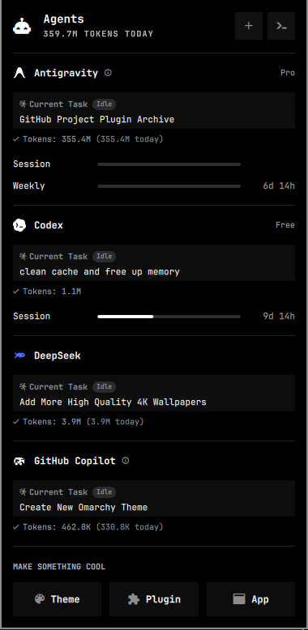

# 🤖 My Agents Tracker (`omarchy-plugin-agents`)

A native AI model and subscription usage tracker for [Omarchy Linux](https://omarchy.org)'s Quickshell bar (`omarchy-shell`). Monitor active quotas, reset schedules, velocity/pace meters, token consumption, and prepaid account balances for 20+ AI providers in one unified bar panel.



## Overview & Basics

My Agents provides a status bar capsule and dropdown panel displaying real-time metrics across all your AI developer accounts. Instead of logging into dozens of provider dashboards, monitor your rate-limits, weekly/monthly resets, and burning speed directly from your status bar.

## Features

- **🌐 Broad AI Provider Support**:
  - Automatically discovers and tracks sessions from:
    - **Anthropic Claude Code** (Sonnet 3.5, Opus 3, Haiku)
    - **OpenAI Codex & ChatGPT** (GPT-4o, o1, o3-mini)
    - **xAI Grok** (Grok 2, Grok 3)
    - **Google Antigravity (AGY)**
    - **Moonshot Kimi**, **Cursor**, **GitHub Copilot**, **Devin**
    - **Ollama** (local inference models)
    - **DeepSeek**, **OpenRouter**, **Fireworks**, **Minimax**, **Qwen**, and more.

- **📈 Rate-Limit & Pace Meters**:
  - Live progress bars for each model and window tier.
  - Precise countdown timers until quota resets (daily, weekly, monthly).
  - Velocity indicators show whether your current pacing will exhaust tokens before the reset window.
  - Warning colors when usage exceeds 80% or 95% of available allowance.

- **👥 Multi-Account & Autoswitch**:
  - Lists individual accounts for providers with multiple keys or subscriptions.
  - Distinct *ACTIVE* indicator showing which profile receives new CLI sessions.
  - Optional **Autoswitch**: seamlessly transitions to a secondary account when primary quota depletes.

- **💳 Prepaid Credit Ledger**:
  - For usage-based and pay-as-you-go providers (e.g. OpenRouter, Fireworks):
  - Fuel-gauge style balance bar showing remaining funds versus spent amounts.
  - Real-time spend tracking and balance alerts.

- **🔄 Multi-Machine Usage Sync**:
  - Export machine-local snapshots and aggregate usage across all your laptops, workstations, and servers using Syncthing, Dropbox, or rsync.

## Bar Widget Controls

| Action | Result |
|---|---|
| **Left-Click** | Opens / Closes the My Agents panel |
| **Hover** | Displays total tokens used today and active model stats |
| **+ Button (Panel)** | Quick-add account for Claude, Codex, Grok, or custom providers |

---

## Installation & Setup

### 1. Dependencies

Ensure Python 3 is installed:

```bash
sudo pacman -S python
```

### 2. Install Plugin

Clone or copy `omarchy-plugin-agents` into your Omarchy plugins directory:

```bash
mkdir -p ~/.config/omarchy/plugins
cp -r omarchy-plugin-agents ~/.config/omarchy/plugins/sushantkr.agents
chmod +x ~/.config/omarchy/plugins/sushantkr.agents/*.sh ~/.config/omarchy/plugins/sushantkr.agents/*.py
```

### 3. Add to Status Bar

Add the widget to `~/.config/omarchy/shell.json` inside your desired bar section (e.g. `right`):

```json
{
  "id": "sushantkr.agents"
}
```

Or enable it using the Omarchy CLI:

```bash
omarchy plugin enable sushantkr.agents right
```

### 4. Reload Shell

```bash
omarchy restart shell
```

---

## Configuration Options

Configure options via `shell.json` or with `omarchy bar set`:

| Key | Default | Description |
|---|---|---|
| `refreshIntervalSec` | `900` | Telemetry refresh frequency in seconds |
| `syncMode` | `"Off"` | `"On"` enables multi-machine snapshot aggregation |
| `syncDir` | `""` | Shared folder path for synced usage snapshots |
| `providers` | `{}` | Per-provider toggles (`{"claude": {"enabled": true}}`) |

---

## License

MIT License © Sushant Kumar
